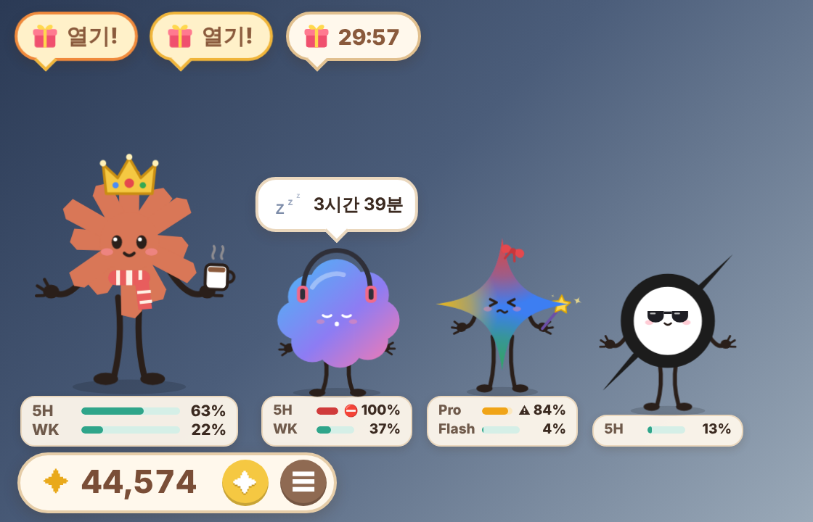
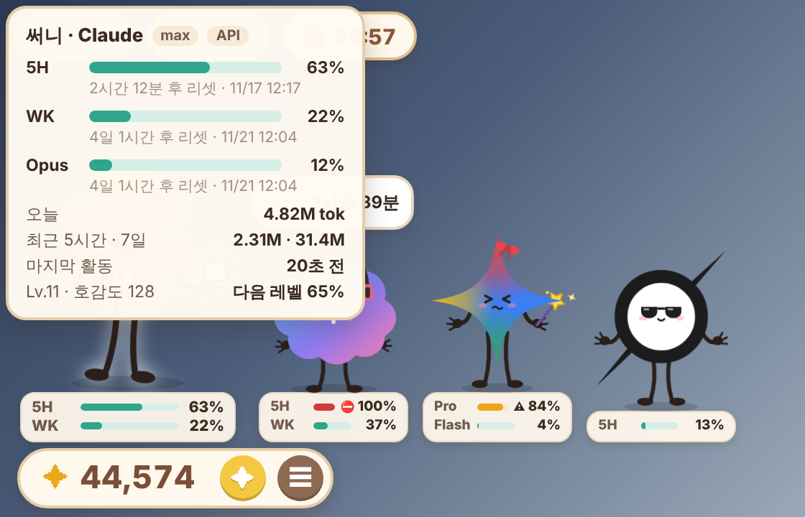
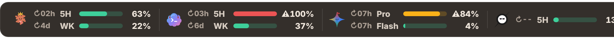
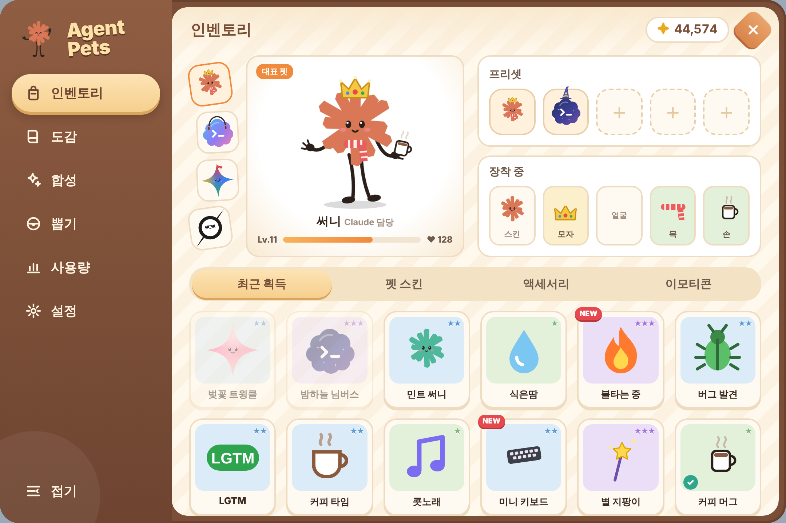
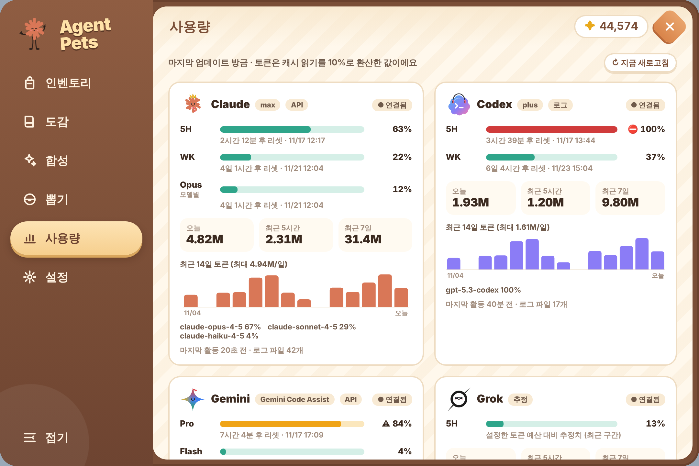
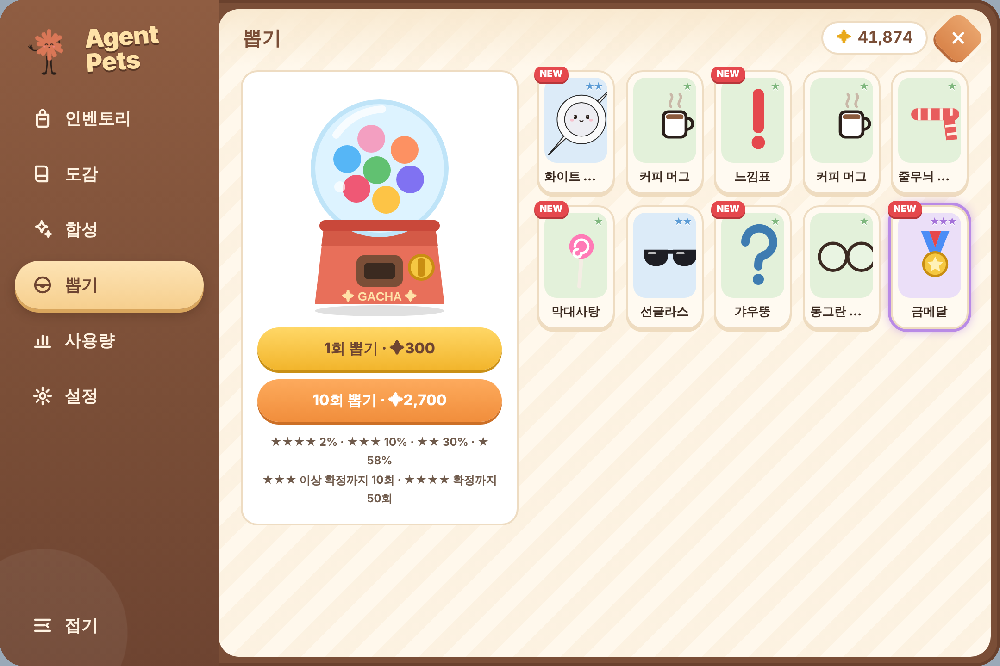
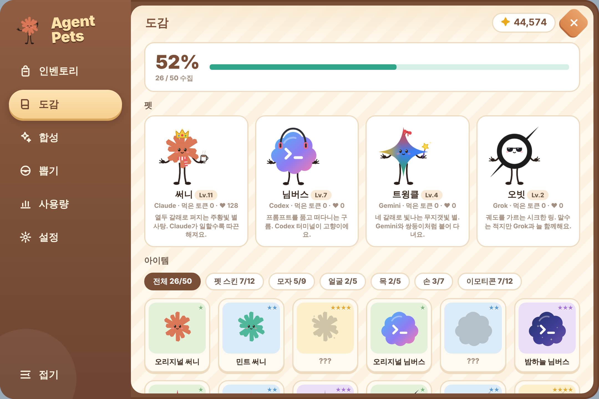

# AgentPets 🐾

**Claude · Codex · Gemini · Grok 사용량 모니터 겸 데스크톱 펫 게임** — Rust(Tauri 2)로 만든 가벼운 데스크톱 앱입니다.

에이전트마다 펫이 한 마리씩 있고, 바탕화면 위에서 사용량을 대신 보여줍니다.
에이전트가 일하면 펫이 달리고, 한도 80%를 넘기면 지쳐 땀을 흘리고, 한도에 걸리면 리셋될 때까지 잠을 잡니다.
처리한 토큰은 ✦ 스파크가 되어 선물 뽑기·꾸미기·합성에 쓸 수 있습니다.

| 데스크톱 펫 | 마우스를 올리면 |
| --- | --- |
|  |  |



| 인벤토리 | 사용량 |
| --- | --- |
|  |  |
| **뽑기** | **도감** |
|  |  |

> 스크린샷은 `npm run preview`(데모 데이터)로 만든 것입니다.

---

## 펫

| 펫 | 담당 | 모습 |
| --- | --- | --- |
| 써니 Sunny | Claude Code | 열두 갈래 주황빛 별사탕 |
| 님버스 Nimbus | Codex CLI | `>_` 프롬프트를 품은 그라데이션 구름 |
| 트윙클 Twinkle | Gemini CLI | 네 갈래 무지갯빛 별 |
| 오빗 Orbit | Grok | 궤도를 가르는 검은 링 |

펫의 상태는 실제 사용량을 따라갑니다.

| 상태 | 조건 | 모습 |
| --- | --- | --- |
| 작업 중 | 최근 2분 안에 토큰 사용 | 제자리 달리기, `…` 말풍선 |
| 지침 | 5H/주간 중 하나라도 80% 이상 | 처진 팔, 느린 숨 |
| 잠 | 한도 100% | `Zzz` + 리셋까지 남은 시간 |
| 미감지 | 로그/한도 정보 없음 | 회색 (설정에서 표시 여부 선택) |

## 기능

- **사용량 모니터**
  - 펫 밑의 미니 게이지(5H / WK), 마우스를 올리면 리셋 시각·오늘/5시간/7일 토큰·마지막 활동 표시
  - 작업 표시줄 위 **사용량 바**: 에이전트별 `↻04h 5H ███ 63%` + CPU/RAM (Codex usage monitor 스타일)
  - 패널의 **사용량** 탭: 한도 게이지, 14일 토큰 막대 그래프, 모델별 비중, 오류/안내
  - 80% / 95% 임계값 알림, 리셋 알림 (임계값 변경 가능)
- **데스크톱 펫**: 항상 위, 드래그 이동, 클릭 통과(투명한 부분은 바탕화면 클릭), 크기 3단계, 우클릭 메뉴, 트레이 아이콘
- **게임**
  - ✦ **스파크**: 에이전트가 처리한 토큰 1,000개(가중치 적용)마다 ✦1, 펫 쓰다듬기(하루 100회까지 ✦1)
  - 🎁 **선물 버블**: 30분 타이머 2개가 항상 돌아가고, 에이전트가 일할수록 빨리 열립니다. 사용량 창이 리셋되면 보너스 선물
  - **뽑기**: 1회 ✦300 / 10회 ✦2,700, ★3 이상 10회·★4 60회 천장
  - **합성**: 같은 등급 중복 3개 → 상위 등급 1개 (★1은 5% 확률로 ★3)
  - **인벤토리/프리셋**: 펫 스킨·모자·얼굴·목·손 아이템 장착, 꾸민 모습 5개 저장
  - **도감**: 스킨 12 · 액세서리 26 · 이모티콘 12 (총 50종) 수집률
  - 펫 **레벨**: 담당 에이전트가 처리한 토큰만큼 경험치, 레벨 업 보상 ✦

## 사용량을 읽는 방법

모든 데이터는 **내 컴퓨터의 로그 파일과 각 CLI가 이미 저장해 둔 로그인 정보**에서 읽습니다.

| 에이전트 | 토큰 집계 (로컬 로그) | 한도 % | 비고 |
| --- | --- | --- | --- |
| **Claude Code** | `~/.claude/projects/**/*.jsonl` (`CLAUDE_CONFIG_DIR`, `~/.config/claude` 도 확인) | `GET api.anthropic.com/api/oauth/usage` — 5시간·주간(+Opus/Sonnet 주간) | 토큰: `~/.claude/.credentials.json` / macOS 키체인 |
| **Codex CLI** | `~/.codex/sessions/YYYY/MM/DD/rollout-*.jsonl` 의 `token_count` 이벤트 (`CODEX_HOME` 지원) | 같은 이벤트의 `rate_limits.primary/secondary` (5시간·주간) | 네트워크 요청 없음 |
| **Gemini CLI** | `~/.gemini/tmp/*/chats/session-*.jsonl` (구버전 `.json`) | Code Assist `retrieveUserQuota` — 모델별 일일 할당량을 Pro/Flash 게이지로 | 토큰: `~/.gemini/oauth_creds.json` |
| **Grok** | `~/.grok/**/*.jsonl, *.json` 의 OpenAI 호환 `usage` | 공식 API 없음 → **설정의 토큰 예산으로 추정** 또는 **사용자 명령어** | |

- 로그는 **새로 추가된 줄만** 읽고(파일별 오프셋 저장), 재개한 세션이 복사한 기록·중복 이벤트는 키 기반으로 걸러냅니다.
- 토큰 수는 **캐시 읽기를 10%로 환산한 가중치**입니다 (입력 + 출력 + 캐시 쓰기 + 캐시 읽기 × 0.1).
- 로그인 토큰은 **읽기만** 하고 갱신·저장·외부 전송하지 않습니다. 만료되었다면 해당 CLI를 한 번 실행하면 갱신됩니다. 요청은 위 공식 엔드포인트로만 갑니다.
- Claude 사용량 엔드포인트와 Gemini 할당량 API는 공개 문서가 없는 내부 API라서 바뀔 수 있습니다. 실패하면 로그 기반 집계는 계속 동작합니다.
- WSL에서 에이전트를 쓴다면 설정 → 에이전트 → **추가 로그 폴더**에 `\\wsl.localhost\Ubuntu\home\<me>\.claude` 처럼 넣으세요.

### 사용자 명령어 (모든 에이전트 공통)

설정에서 명령어를 지정하면 그 출력이 게이지를 대신합니다. 공식 한도를 아는 다른 도구가 있을 때 유용합니다.

```json
{ "plan": "SuperGrok", "windows": [ { "label": "5H", "usedPercent": 42, "resetsAt": "2026-11-17T12:00:00Z" } ] }
```

## 설치 / 빌드

필요한 것: [Rust](https://rustup.rs) (stable), Windows는 WebView2 런타임(Windows 10/11 기본 포함), Linux는 `libwebkit2gtk-4.1-dev libayatana-appindicator3-dev librsvg2-dev libxdo-dev`.

Tauri CLI로 실행/번들링합니다 (둘 중 하나):

```bash
cargo install tauri-cli --version "^2" --locked
```

```bash
npm install
```

개발 실행:

```bash
cargo tauri dev
```

설치 파일 만들기 (Windows: `.msi`/NSIS `.exe`, macOS: `.dmg`, Linux: AppImage/deb):

```bash
cargo tauri build
```

결과물은 `target/release/bundle/` 에 생깁니다. CLI 없이 실행 파일만 필요하면 `cargo build --release -p agentpets` 후 `target/release/agentpets(.exe)` 를 실행하면 됩니다.
GitHub Actions의 **CI → Run workflow** 로도 Windows/macOS/Linux 설치 파일을 받을 수 있습니다.

## 사용법

- 펫을 **드래그**해서 옮기고, **클릭**하면 쓰다듬기(♥), **더블클릭**하면 사용량 패널, **우클릭**하면 메뉴
- 알약 모양 바의 ✦ 버튼 = 뽑기, ☰ 버튼 = 패널
- 왼쪽 위 🎁 버블이 `열기!` 가 되면 클릭해서 선물 받기
- 창을 모두 닫아도 트레이 아이콘에 남아 있습니다 (트레이 → 종료)
- 데이터 위치: Windows `%APPDATA%\dev.agentpets.usage-monitor`, macOS `~/Library/Application Support/dev.agentpets.usage-monitor`, Linux `~/.local/share/dev.agentpets.usage-monitor`

## 개발

```
crates/core/        순수 Rust 로직 (UI 없음, cargo test)
  src/usage/        claude.rs codex.rs gemini.rs grok.rs — 로그 파서/API, ledger.rs — 중복 제거 토큰 원장
  src/game.rs       스파크 · 선물 · 뽑기 · 합성 · 장착 규칙
  tests/usage.rs    가짜 홈 폴더 + 가짜 HTTP 로 4개 에이전트 end-to-end 테스트
src-tauri/          Tauri 셸: 창(펫/패널/바), 트레이, 메뉴, 알림, 클릭 통과, 백그라운드 폴링
ui/                 웹뷰 화면 (HTML/CSS/JS, 빌드 단계 없음)
  shared/mascots.js 펫 · 액세서리 · 이모티콘 SVG 아트
  shared/catalog.json 펫/아이템 카탈로그 (Rust 코어도 같은 파일을 컴파일해 사용)
scripts/            preview.js(데모 데이터 스크린샷), make-icons.js, mock-*.js
```

```bash
cargo test --workspace
```

`npm run preview` 는 [Playwright](https://playwright.dev)(`npm i -D playwright`)로 모든 창을 데모 데이터와 함께 `docs/screenshots/` 에 렌더링합니다.

## 참고 / 고지

- Claude, Codex, Gemini, Grok은 각 회사의 상표이며 이 프로젝트는 어느 회사와도 관련 없는 비공식 도구입니다. 펫 캐릭터와 아이템은 이 프로젝트를 위해 새로 그린 SVG입니다.
- Linux에서는 트레이 아이콘에 AppIndicator가, 클릭 통과에는 X11 입력 영역 지원이 필요합니다.

MIT License
