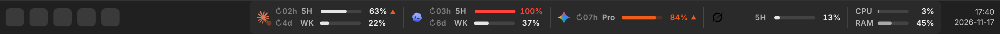
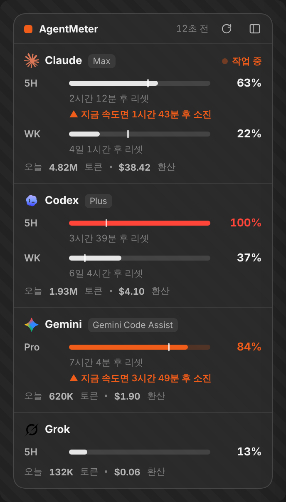
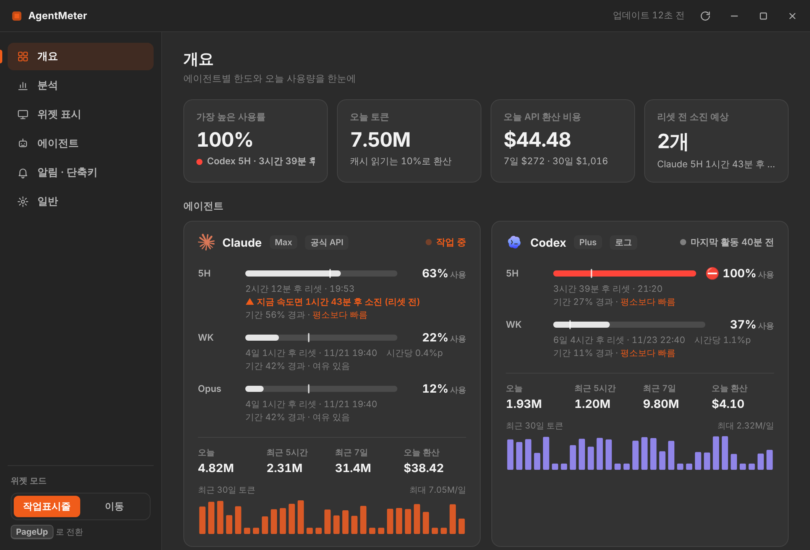
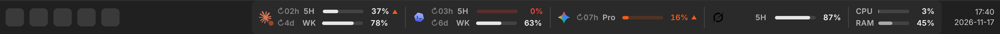
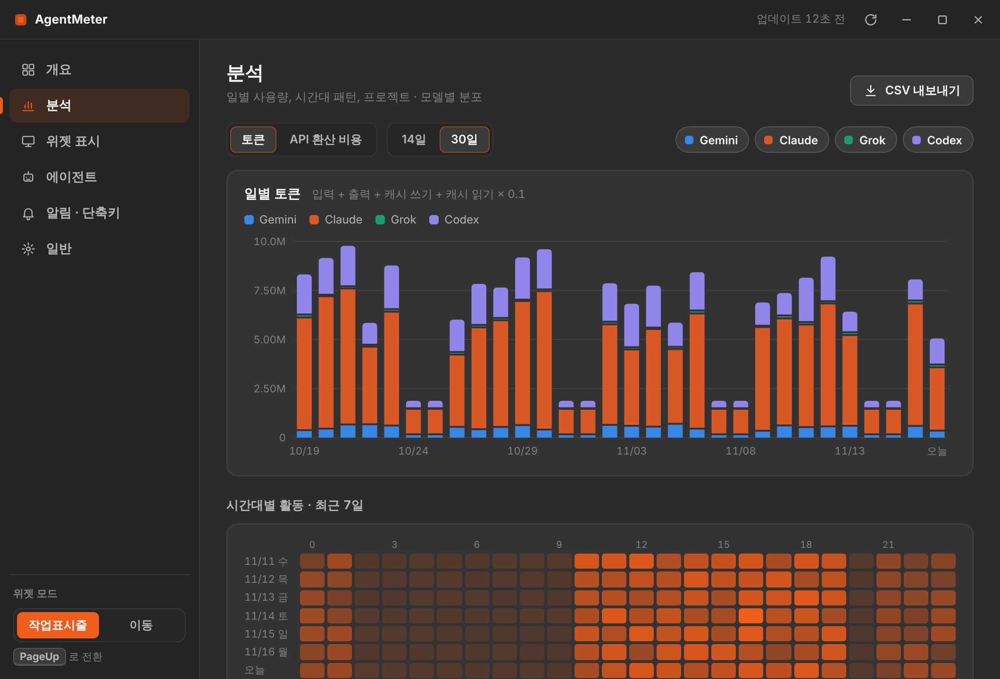
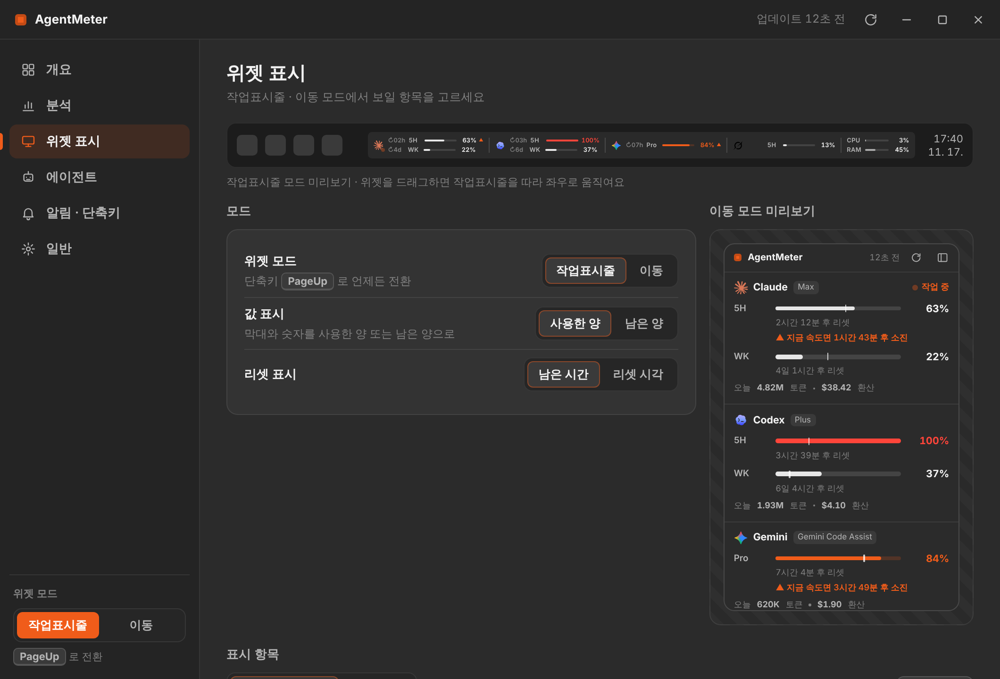

# AgentMeter

Claude Code · Codex · Gemini CLI · Grok 사용량을 **작업표시줄에 붙여 두거나, 떠 있는 위젯으로** 보여주는 모니터입니다.
5시간·주간 한도가 얼마나 찼는지, 리셋까지 얼마나 남았는지, 지금 속도로 리셋 전에 바닥나는지를 한눈에 봅니다. (Rust + Tauri 2)



| 카드형 | 대시보드 |
| --- | --- |
|  |  |

## 위젯 레이아웃 — `PageUp` 으로 전환

| | 가로형 (기본) | 카드형 |
| --- | --- | --- |
| 모양 | `↻02h 5H ▬▬▬ 63%` 처럼 한 줄 (에이전트당 두 줄까지) | 에이전트별 카드: 한도, 리셋, 소진 예측, 오늘 토큰·비용 |
| 위치 | **작업표시줄에 붙이기**(시계 왼쪽, 좌우로만 이동) 또는 바탕화면 어디든 | 화면 어디든 |
| 스냅 | 위로 끌어내면 떨어지고, 작업표시줄 가까이에 놓으면 다시 붙어요 | — |

- **`PageUp`** : 레이아웃 전환 · **`Shift+PageUp`** : 위젯 숨기기/보이기 · 대시보드 단축키는 원하면 지정
- 단축키는 대시보드 → **알림 · 단축키**에서 바꾸거나 끌 수 있어요. 전역 단축키라서 켜 두면 다른 앱에서 PageUp 키를 쓸 수 없습니다 — 문서 작업이 많다면 `Ctrl+PageUp` 등으로 바꾸세요.
- 위젯 **더블클릭** = 대시보드, **⚙** = 위젯 설정, **우클릭** = 메뉴 (레이아웃 전환, 작업표시줄에 붙이기, 위치 고정, 남은 양으로 표시, 숨기기…), 트레이 아이콘 클릭 = 대시보드
- 전체화면 앱(영상·게임)이 앞에 있으면 위젯이 그 뒤로 빠져요.

## 모양 (테마)

대시보드 → **모양**에서 Codex 앱 설정처럼 바꿀 수 있어요. 모든 값은 정해진 범위 안에서만 움직여서 깨지지 않아요.

- **모드**: 시스템 · 라이트 · 다크
- **테마 프리셋**: AgentMeter, 미드나잇, 노르딕, 포레스트, 그래파이트, 로즈 (각각 라이트/다크)
- **액센트 · 배경색 · 글자색** 직접 지정 (글자 대비가 낮으면 경고), **글꼴**, 대시보드 크기 90–125%
- 위젯: 배경 불투명도, 전체 크기, 가로형 막대 길이, 떠 있는 가로형 높이, 카드형 폭, 모서리 둥글기

## 표시 옵션

대시보드 → **위젯 표시**에서 미리보기를 보면서 레이아웃별로 따로 켜고 끕니다.

- **사용한 양 / 남은 양** 표시 선택 (`63%` ↔ `37% 남음`) · 리셋을 **남은 시간 / 시각**으로
- 로고 · 이름 · 창 라벨 · 막대 · 퍼센트 · 리셋 · 기간 경과 눈금 · 소진 예측 · 토큰 · 비용 · CPU/RAM · 모델별 한도(Opus 주간, Gemini Flash…) 각각 켜기/끄기
- 개요 화면 위쪽 체크박스로 **보여줄 에이전트 선택** (개요와 위젯에 함께 적용, 숨겨도 수집은 계속), 한도 창(5H / WK / Opus…)별로 숨기기
- 항상 위에, 위치 고정, 위치 초기화 · Claude는 **Fable 사용량** 켜기/끄기



## 기능

- **공식 한도 %** — Claude 5시간·주간(+모델별), Codex 5시간·주간(계정 전체), Gemini 일일 할당량. 에이전트를 쓰는 중이면 1분 안에 다시 확인
- **소진 예측** — 최근 사용 속도(%/시간)로 바닥나는 시각을 계산하고, 리셋 전에 바닥날 것 같으면 `▲ 지금 속도면 40분 후 소진` 표시 + 알림 (한 주기에 한 번)
- **페이스** — 막대 위 눈금이 한도 기간이 얼마나 지났는지 보여줘서 "평소보다 빠름 / 여유 있음"을 바로 판단
- **API 환산 비용** — 모델별 공개 API 가격으로 오늘·5시간·7일·30일 비용 추정 (구독 요금이 아니라 같은 양을 API로 썼을 때의 금액). **달러 / 원(₩) / 둘 다** 선택, 환율은 하루 두 번 자동 갱신(open.er-api.com) 또는 직접 입력
- **분석** — 일별 토큰/비용 누적 차트(14·30일), 시간대별 활동 히트맵, 프로젝트별·모델별 사용량, **CSV 내보내기**
- **알림** — 임계값(기본 80% / 95%) 도달, 한도 리셋, 리셋 전 소진 예상
- **트레이 게이지** — 트레이 아이콘이 가장 높은 사용률을 링으로 표시, 툴팁에 전체 요약
- **원클릭 연결** — Claude Code · Codex · Gemini CLI 로그인이 없으면 버튼 하나로 터미널을 열어, CLI가 없으면 설치(npm, Claude는 Node.js 없이 공식 설치 프로그램)하고 로그인까지 진행. 로그인이 끝나면 자동으로 감지해 새로고침 (비밀번호는 각 CLI가 처리하고 AgentMeter는 CLI가 저장한 파일만 읽음)
- 작업 중 표시(최근 2분 내 활동), 시스템 시작 시 자동 실행, 폴링 주기 설정

| 분석 | 위젯 표시 설정 |
| --- | --- |
|  |  |

## 사용량을 읽는 방법

모든 데이터는 **내 컴퓨터의 로그 파일과 각 CLI가 이미 저장해 둔 로그인 정보**에서 읽습니다.

| 에이전트 | 토큰 집계 (로컬 로그) | 한도 % | 비고 |
| --- | --- | --- | --- |
| **Claude Code** | `~/.claude/projects/**/*.jsonl` (`CLAUDE_CONFIG_DIR`, `~/.config/claude` 도 확인) | `GET api.anthropic.com/api/oauth/usage` — 5시간·주간(+Opus/Sonnet 주간) | 토큰: `~/.claude/.credentials.json` / macOS 키체인 |
| **Codex CLI** | `~/.codex/sessions/YYYY/MM/DD/rollout-*.jsonl` 의 `token_count` 이벤트 (`CODEX_HOME` 지원) | `GET chatgpt.com/backend-api/wham/usage` — 계정 전체 5시간·주간 (다른 PC·클라우드 사용 포함), 실패하면 세션 로그의 `rate_limits` | 토큰: `~/.codex/auth.json` |
| **Gemini CLI** | `~/.gemini/tmp/*/chats/session-*.jsonl` (구버전 `.json`) | Code Assist `retrieveUserQuota` — 모델별 일일 할당량 (Pro/Flash) | 토큰: `~/.gemini/oauth_creds.json` |
| **Grok** | `~/.grok/**/*.jsonl, *.json` 의 OpenAI 호환 `usage` | 공식 API 없음 → **토큰 예산으로 추정** 또는 **사용자 명령어** | |

- 로그는 **새로 추가된 줄만** 읽고(파일별 오프셋 저장), 재개한 세션이 복사한 기록·중복 이벤트는 키 기반으로 걸러냅니다.
- 토큰 수는 **캐시 읽기를 10%로 환산한 가중치**입니다 (입력 + 출력 + 캐시 쓰기 + 캐시 읽기 × 0.1).
- 프로젝트는 로그에 남은 작업 폴더(`cwd`) 이름으로 묶습니다.
- 로그인 토큰은 **읽기만** 하고 갱신·저장·외부 전송하지 않습니다. 만료되었다면 해당 CLI를 한 번 실행하면 갱신됩니다. 요청은 위 공식 엔드포인트로만 갑니다.
- Claude·Codex 사용량 엔드포인트와 Gemini 할당량 API는 공개 문서가 없는 내부 API라서 바뀔 수 있습니다. 실패하면 로그 기반 집계는 계속 동작합니다.
- WSL에서 에이전트를 쓴다면 대시보드 → 에이전트 → **추가 로그 폴더**에 `\\wsl.localhost\Ubuntu\home\<me>\.claude` 처럼 넣으세요.

### 사용자 명령어 (모든 에이전트 공통)

에이전트 설정에 명령어를 지정하면 그 출력이 한도 게이지를 대신합니다. 공식 한도를 아는 다른 도구가 있을 때 유용합니다.

```json
{ "plan": "SuperGrok", "windows": [ { "label": "5H", "usedPercent": 42, "resetsAt": "2026-11-17T12:00:00Z" } ] }
```

## 설치

### 그냥 실행하기 (Windows)

1. GitHub 저장소의 **Actions → CI → 가장 최근 실행 → Artifacts** 에서 `agentmeter-windows-latest` 를 내려받아 압축을 풉니다.
   - `agentmeter.exe` : 설치 없이 바로 실행되는 단일 실행 파일
   - `bundle/nsis/*-setup.exe`, `bundle/msi/*.msi` : 시작 메뉴/제거 기능이 있는 설치 파일
2. 더블클릭해서 실행합니다. "Windows의 PC 보호" 창이 뜨면 **추가 정보 → 실행** (서명되지 않은 개인 빌드라서 뜨는 경고입니다).
3. 작업표시줄 오른쪽(시계 왼쪽)에 위젯이, 트레이에 게이지 아이콘이 생깁니다. 처음 실행하면 대시보드가 열립니다.

Artifacts가 없다면 Actions → CI → **Run workflow** 로 새로 만들 수 있습니다 (10분 정도).
Windows 10/11에는 필요한 WebView2 런타임이 기본으로 들어 있습니다.

### 자동 업데이트

이 브랜치에 푸시할 때마다 GitHub Actions(`Release` 워크플로)가 서명된 Windows 설치 파일을 `v0.2.<번호>` 릴리스로 올립니다.
실행 중인 AgentMeter는 시작 20초 뒤와 3시간마다 새 버전을 확인하고, 있으면 **알림 → 내려받기 → 설치 → 다시 시작**까지 알아서 합니다.
대시보드 → 일반 → 업데이트에서 지금 확인하거나 자동 업데이트를 끌 수 있고, 현재 버전은 대시보드 제목 옆에 표시됩니다.

저장소 설정이 한 번 필요합니다: **Settings → Secrets and variables → Actions → New repository secret** 에
이름 `TAURI_SIGNING_PRIVATE_KEY`, 값으로 업데이트 서명 개인 키 파일(`agentmeter.key`)의 내용을 넣으세요.
이 키가 없으면 릴리스 단계는 건너뜁니다. 키를 잃어버리면 이미 설치된 앱은 더 이상 자동 업데이트를 받을 수 없습니다(공개 키가 앱에 들어 있음).

### 소스에서 빌드하기

필요한 것: [Git](https://git-scm.com), [Rust](https://rustup.rs) (stable). Linux는 `libwebkit2gtk-4.1-dev libayatana-appindicator3-dev librsvg2-dev libxdo-dev` 도 필요합니다.

```bash
git clone -b claude/upbeat-bardeen-03j27a https://github.com/cheapbutsimilar/agents_usage_monitor
```

```bash
cd agents_usage_monitor
```

바로 실행 (첫 빌드는 몇 분 걸립니다):

```bash
cargo run --release -p agentmeter
```

설치 파일(.msi / setup.exe)까지 만들기 — `cargo install tauri-cli --version "^2" --locked` 후 **저장소 폴더 안에서**:

```bash
cargo tauri build
```

결과물: `target/release/agentmeter.exe`, `target/release/bundle/`. (`cargo tauri ...` 명령은 반드시 `agents_usage_monitor` 폴더 안에서 실행해야 합니다.)

## 미리보기하면서 개발하기

저장소 폴더의 `.bat` 파일을 더블클릭하거나, **저장소 폴더 안에서** 명령을 실행하세요.

| 하고 싶은 것 | Windows | 명령 |
| --- | --- | --- |
| **브라우저 미리보기** — 앱 빌드 없이 데모 데이터로 작업표시줄 위젯·이동 위젯·대시보드를 한 화면에 | `preview.bat` | `cargo run -p agentmeter-devserver` |
| **실제 앱 개발 모드** — 내 진짜 사용량으로 앱 실행 | `dev.bat` | `cargo tauri dev` |
| **배포용 빌드** — `agentmeter.exe` + 설치 파일 | `build.bat` | `cargo tauri build` |

**브라우저 미리보기** (`http://localhost:1420` 이 자동으로 열립니다)
- `ui/` 아래 파일을 저장하면 바로 반영됩니다. CSS는 새로고침 없이 교체되고, JS/HTML은 자동 새로고침됩니다.
- 위쪽 버튼으로 **Claude 40% / 작업 중 / 85% 소진 예상 / 100%**, **사용한 양 ↔ 남은 양**, **리셋 표시 방식**을 바로 시험할 수 있어요.
- 대시보드에서 바꾼 설정은 위젯 미리보기에도 바로 반영됩니다.
- 다른 포트: `cargo run -p agentmeter-devserver -- --port 1421` · 브라우저 자동 열기 끄기: `-- --no-open`

**실제 앱 개발 모드**
- `ui/` 파일을 저장하면 앱 창이 자동으로 새로고침됩니다.
- `src-tauri/`, `crates/core/` 의 Rust 코드를 저장하면 자동으로 다시 빌드하고 재시작합니다.

**어디를 고치면 되나요?**

```
ui/widget/         위젯 창 (작업표시줄 / 이동 모드 공용)
ui/dashboard/      대시보드: 개요 · 분석 · 위젯 표시 · 에이전트 · 알림·단축키 · 일반
ui/shared/         tokens.css(색상·디자인 토큰), render.js(위젯 그리기), widget.css, logos.js(공식 로고), util.js
crates/core/       Rust 로직 — usage/(Claude · Codex · Gemini · Grok 수집기, 예측), pricing.rs(모델 가격), settings.rs
src-tauri/         창 배치 · 단축키 · 트레이 게이지 · 알림 · 백그라운드 폴링
crates/devserver/  브라우저 미리보기 서버
scripts/           mock-api.js(데모 데이터), preview.js(스크린샷), make-icons.py(아이콘)
```

테스트:

```bash
cargo test --workspace
```

README 스크린샷 다시 만들기: `npm run screenshots` ([Playwright](https://playwright.dev) 필요). 아이콘 다시 그리기: `npm run icons` (Pillow 필요).

## 디자인

- 베이스 `#2B2B2B`, 키 컬러 `#F05C1A`. 막대는 평소 밝은 회색 → 첫 번째 임계값부터 주황 → 두 번째부터 빨강(아이콘 동반)으로, 색만으로 상태를 구분하지 않게 했습니다.
- 차트의 에이전트 색은 어두운 배경에서 구분되도록 검증한 팔레트(Gemini 파랑, Claude 주황, Grok 초록, Codex 보라)를 씁니다.

## 참고 / 고지

- **비용은 추정치입니다.** 공개 API 가격표(모델명 기준)로 계산하며, 실제 구독 요금이나 청구 금액과 다릅니다. 가격표에 없는 모델은 비용에서 빠집니다.
- Claude, Codex(OpenAI), Gemini, Grok(xAI)의 이름과 로고는 각 회사의 상표이며, 이 프로젝트는 어느 회사와도 관련 없는 비공식 도구입니다. 로고 SVG는 [@lobehub/icons](https://github.com/lobehub/lobe-icons) (MIT)에서 가져왔습니다.
- 작업표시줄 모드는 Windows 기준으로 만들었습니다(작업표시줄 높이·위치 자동 감지, 항상 위 유지). macOS·Linux에서는 작업 영역 밖의 띠(독·패널·메뉴 막대)에 붙고, 없으면 화면 맨 아래에 붙습니다.
- Linux에서는 트레이 아이콘에 AppIndicator가 필요합니다.

MIT License
